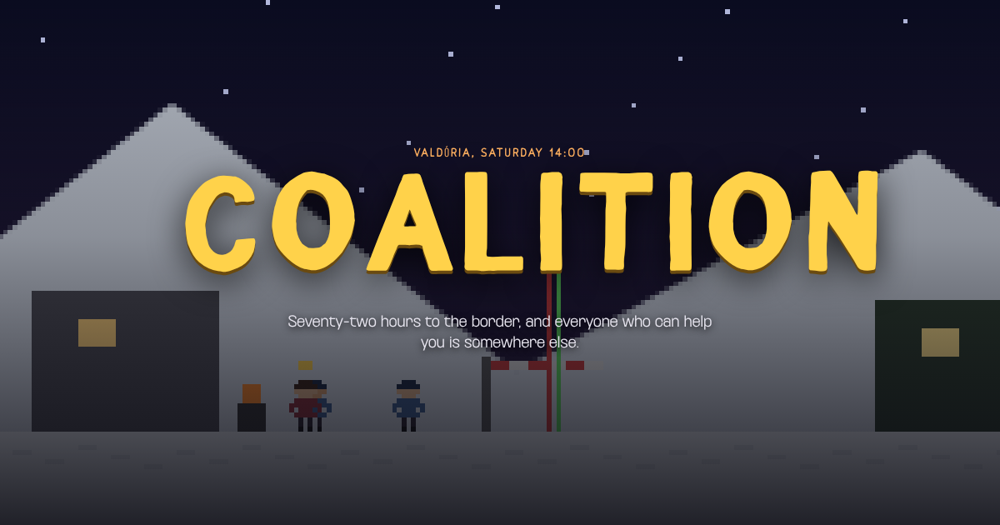

# Coalition

**72 hours. Escape Valdória, get caught or be the capturer!**

Coalition is a turn-based game about coordinating people under pressure. You can
have money, political influence and powerful friends, but you still need someone
to drive, answer the phone or let an aircraft leave.



Set in Ron Bronson's [Nelosphere world](https://github.com/quarterback/kels).
Single-player, built for phones and desktop browsers. The current build has
three playable characters, two sides and six journey locations.

## Play

Download the repository and open `index.html` in a browser. The game, fonts and
sound work without an internet connection.

Start with **Play the tutorial** to learn the escape route. It guides you to the
border, then hands the airfield over to you. Or choose a character and start a
regular run.

| Character | Your task |
| --- | --- |
| Teresā Albukerkē | Escape after losing the election. Your brother Duartē arranges the aircraft. |
| Matēu Zanetī | Escape the same pursuit. Your sister Līviā works on your departure from abroad. |
| Sofīā Leōnī | Coordinate the government inquiry. Follow reports, send orders and try to bring the candidate to the hearing. |

The two candidates share the escape rules. Sofīā has a different set of actions
and sees reports instead of the candidate's actual location.

## The escape

Travel from Portô Venla through Santa Laura, Nova Trentô and Salta to the Huhūi
border. Cross into Esmeralda, reach Susana airfield and depart for Atlanta.
There is one border crossing. You win when the jet leaves Esmeraldan airspace.

Preparation continues while you travel. Your sibling books the charter and
crew. Vélez arranges reception across the border. Salek seeks an entry visa for
Atlanta. Their work takes time and may fail. A promise is not a confirmation.

Cards are help from particular people. Each card lists where it works and which
actions it helps. A party contact has influence in Valdória; that influence does
not carry into Esmeralda. Choices also create promises you may have to keep later.

Money is available. The question is whether someone will accept it. Failed
approaches can cost time or expose your location. The inquiry acts every three
game hours; at exposure 10, its officers arrive. You have 72 game hours to escape.

## The inquiry

As Sofīā, you work through Inspector Sosā, provincial desks and foreign contacts.
You decide where to look, which reports to follow and whom to ask for help.
Reports can arrive late, and a sighted vehicle does not prove who was inside.

You can search a suspected location, question helpers, set a roadblock or work
to interrupt the charter. Across the border, you need Esmeralda's cooperation.
A request sent to a ministry still has to reach the people who can act on it.

The debrief reveals the candidate's route alongside the places you searched.
It distinguishes custody, an escaped flight and a run that ended without the
candidate in custody.

## Controls, saves and offline play

Choose an action, inspect its requirements and chances, then commit. Time moves
when you act, so you can read and think before deciding.

On phones, switch between **Here**, **Phone**, **Route** and **Hand**. The Route
board distinguishes help in hand, work promised and arrangements not started.

The game saves your run in the current browser after each move. Choose
**Continue your run** on the start screen to resume. Saves do not sync across
devices; clearing browser storage removes them.

When hosted over HTTPS, the game supports installation to a phone's home screen
and offline play after its files have been cached. Use **Install** when offered.
On an iPhone, use **Share → Add to Home Screen**. Installation is optional.

## Build and check

No package installation is needed to build. Use Python 3:

```bash
python3 tools/build.py
```

This embeds the renderer, scripts, fonts and favicon in `index.html`, and writes
`manifest.webmanifest` and `sw.js`. Host those files together with `icons/` to
support installation and offline caching. `_headers` supplies Cloudflare cache
rules for the worker and manifest.

Run the guided-run check with Node.js:

```bash
node tools/tutorial-check.js
```

Measure the escape simulation across seeded runs:

```bash
node tools/calibrate.js 500
```

Calibration uses a fixed computer policy; its results are not human win rates.

## Source map

| Path | Purpose |
| --- | --- |
| `src/data.js` | Characters, cards, locations, approaches and inquiry orders |
| `src/sim.js` | Escape rules, seeded randomness and saved state |
| `src/gov.js` | Government role, hidden candidate, reports and debrief |
| `src/tutorial.js` | Guided escape run |
| `src/ui.js` | Panels, decisions, saves and installation controls |
| `src/render.js` | PixiJS scenes, sprites, lighting, weather and 2D fallback |
| `src/audio.js` | Synthesized music and sound effects |
| `src/shell.html`, `src/style.css` | Page, typography and link-preview metadata |
| `vendor/pixi.min.js` | Pinned PixiJS 8.21.0 |
| `fonts/` | Licensed webfonts and their required notices |
| `og/card.png` | 1200 × 630 social-preview image |
| `tools/build.py` | Offline HTML build, manifest and service worker |

## Design and contribution rules

Read [AGENTS.md](AGENTS.md) before changing the game. It records the owner's
copy, typography and renderer requirements. The [game direction](docs/game-direction.md)
and [government character map](docs/government-character-plan.md) explain the
coordination story. Content and balance are still developing; inspect the active
sources for the current rules.

Apply [Humanizer](https://github.com/blader/humanizer) and
[federal plain-language guidance](https://digital.gov/guides/plain-language)
to player text. Keep costs, requirements and consequences clear. Use GC North
Sans for reading and headings, Little Grandad for the title and the approved
Overbit faces for compact numeric displays.

Code is under [MPL 2.0](LICENSE). PixiJS has its own MIT license; the purchased
webfonts have separate terms in [fonts/LICENSES.md](fonts/LICENSES.md).
